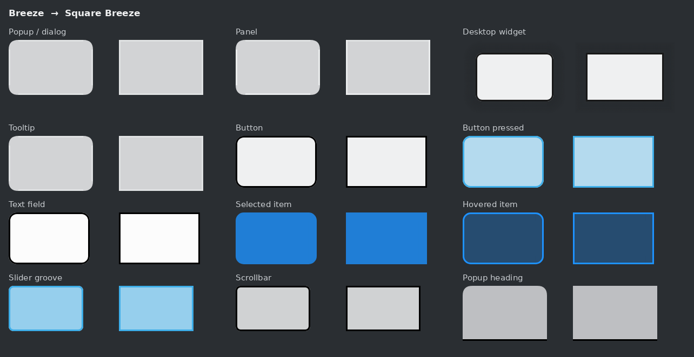

# Square Breeze

A Plasma Style (desktop theme) for KDE Plasma 6 that is Breeze with every corner squared:
panels, popups, tooltips, desktop widgets, buttons, text fields, list highlights,
sliders, scrollbars, the volume/brightness OSD and more. Colours, borders, spacing,
blur and shadows stay exactly as Breeze has them, and the theme follows your colour
scheme like Breeze does.



Pair it with [Klassy](https://github.com/paulmcauley/klassy) at radius 0 (see below) for
a fully square desktop.

## Install

**From a release (easiest).** Download `square-breeze-<version>.tar.gz` from the
[Releases](../../releases) page, then *System Settings → Colors & Themes → Plasma Style →
Install from File…* and pick the archive. Or from a terminal:

```sh
kpackagetool6 --type Plasma/Theme --install square-breeze-*.tar.gz
plasma-apply-desktoptheme square-breeze
```

**From a clone.**

```sh
git clone https://github.com/Anthony-S45/square-breeze
cd square-breeze
./install.sh            # installs to ~/.local/share/plasma/desktoptheme/square-breeze
```

Nothing outside your home folder is touched. `./install.sh --uninstall` removes it.

### After Plasma updates

The theme only overrides the files it changes. Everything else falls back to the
Breeze installed on your system, so most Plasma updates need nothing from you. If a
Plasma release redraws one of the overridden files, regenerate the theme from your own
Breeze:

```sh
./install.sh --build    # needs python3 with lxml and pillow
```

(The prebuilt `package/` was generated from Breeze in Plasma 6.7.5.)

## Klassy settings

The Plasma Style covers the Plasma shell. Application windows and widgets are drawn by
your window decoration and application style. With Klassy:

- **Window Decoration → Klassy → Window shape → Corner radius: 0**
- **Application Style → Klassy → configure**: make sure the button/frame radius is
  **0**, either by deriving it from the window decoration or by setting a custom value of
  0. A custom radius of 1 still looks slightly rounded.

## What is and isn't squared

Squared, in the regular, *opaque*, *solid* and *translucent* variants: popups and
dialogs, panels, tooltips, desktop widget backgrounds (keeping their soft shadow),
buttons and tool buttons in every state, focus rings, text fields, list and view
highlights, menu bar items, popup headers and footers, slider grooves, scrollbars, the
OSD meters, frames and toolbars, plus the blur/contrast masks behind them.

Deliberately kept:

- **Round controls stay round.** Slider handles, radio buttons, switch knobs and busy
  indicators aren't frames, so they keep their circles.
- **Drop shadows stay soft.** The surface is square and the shadow follows it.
- **Active-tab line.** Breeze draws it shorter than the tab on purpose. That's an
  inset, not a rounded corner.
- **Legacy assets** that Plasma 6 doesn't use (`monitor`, `picker` and the
  bitmap-based selected `media-delegate`).

## Optional: square desktop selection box

The rectangle you drag on the desktop to select icons, and the box around an icon's name
while renaming it, aren't drawn by the Plasma Style. The desktop's QML hard-codes their
radius (`Kirigami.Units.cornerRadius`). To square them too:

```sh
extras/square-desktop.sh            # undo with: extras/square-desktop.sh --remove
```

This copies the desktop containment from *your installed Plasma* into
`~/.local/share/plasma/plasmoids/` with only those two radius lines set to 0, and
restarts plasmashell. A systemd drop-in re-syncs the copy every time plasmashell starts,
so after a Plasma update you get the new desktop code with the same two-line change. If
a future Plasma draws the box differently, the override removes itself instead of
going stale. (Plasma started without systemd: re-run the script after updates.)

**Known limitation:** a few other Plasma/Kirigami elements, such as the thumbnail grids
in System Settings, also round their corners in QML code rather than in Plasma Style
SVGs, so no Plasma Style can square them.

## How it works

`tools/build.py` reads stock Breeze and writes the theme. Nothing is hand-drawn. For
every nine-slice frame it rebuilds each corner from its two neighbouring edges: every
layer of an edge (fill, border, highlight, margin, shadow) is a straight strip, and in a
square frame that strip just continues around the corner. Frames whose corners are
already square are left to Breeze. `tools/verify.py` then rasterises every frame
the way Plasma lays it out, and checks that each corner is an exact square
continuation of its edges.

```sh
# regenerate from a libplasma checkout or an installed Breeze
python3 tools/build.py --source /usr/share/plasma/desktoptheme/default --out package
# check every frame (needs python3-playwright with Chromium, numpy, pillow)
python3 tools/verify.py --source /usr/share/plasma/desktoptheme/default --theme package --sheets /tmp/sheets
# before/after image, release archive
python3 tools/preview.py --source /usr/share/plasma/desktoptheme/default --theme package --out docs/preview.png
tools/release.sh
```

To keep a particular frame rounded, add it to `KEEP_ROUND` in `tools/build.py`.

## License

LGPL-2.1-or-later, the same as the Breeze artwork it is derived from (© KDE Visual
Design Group). See [LICENSE](LICENSE).
